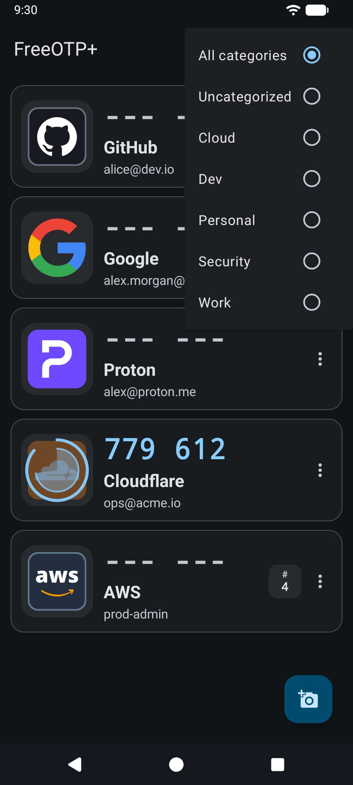
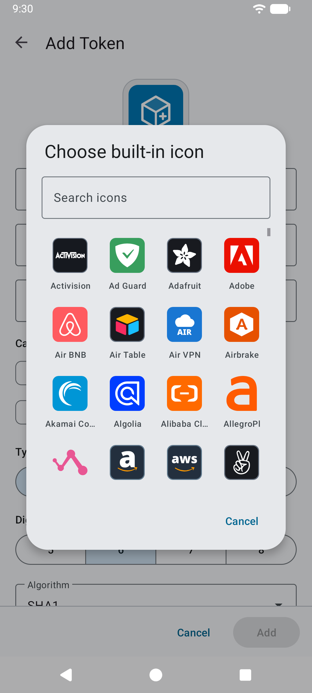

# FreeOTP Plus

FreeOTP Plus forked the same functionality of [FreeOTP](https://github.com/freeotp/freeotp-android) provided by RedHat with the following enhancement:
* Export settings to Google Drive or other document providers (plaintext or encrypted)
* Import settings from Google Drive or other document providers (with automatic encrypted backup detection)
* Lots of stability improvement
* Support Android 6.0 permissions.
* Enhanced UI with material design v3 with dark theme support
* Search bar to search token
* Provide more token details for better interoperatibility with other apps
* Utilize modern camera hardware to scan QR code faster
* Three authentication modes: **No encryption**, **App launch** (Biometric / PIN), and **Token encrypted** (AES-256-GCM encrypted token secrets unlocked via biometric or manual key)
* Heuristic based offline icon for tokens of 250+ websites
* Categorize tokens and filter by category
* More settings to customize the app functionality

Most part of the code is re-written with modern Jetpack libraries and Kotlin language.

## Requirements

* Android 6.0+

## Screenshots

## Build Dependencies

* Android SDK
* Android Studio 4.0+

## Translate

[Crowdin](https://crowdin.com/project/freeotpplus) can be used for translation if you are uncomfortable working with strings.xml files.
If your language is not listed, please open an issue so we can add it.
If you don't like to use Crowdin feel free to submit a pull with the updated/added locales.

Link: https://crowdin.com/project/freeotpplus

## Authentication Modes & Token Encryption

Under **Authentication mode** in the menu, FreeOTP+ supports three modes:

* **No encryption**: Default mode without an authentication prompt on launch; token secrets are stored unencrypted in app-private storage.
* **App launch**: Prompts for Biometric or device PIN/credential when opening the app, without encrypting token secrets in storage.
* **Token encrypted**: Encrypts token secrets at rest with AES-256-GCM using a user-supplied key (minimum 6 characters, derived via PBKDF2-HMAC-SHA256). The key is encrypted with `AndroidKeyStore` strong biometrics when available so launching the app with biometrics automatically unlocks your tokens. If biometrics are not enrolled or become invalidated (e.g., new biometric enrolled or app restored to a new phone), you will be prompted to enter your key manually with the option to enable/re-enable biometric unlock.
  * To rotate your encryption key, switch out of **Token encrypted** mode (which decrypts stored secrets after confirmation) and switch back into **Token encrypted** mode with a new key.
  * When exporting backups (JSON or Key URI) in **Token encrypted** mode, you can choose to export **encrypted** (`freeotp-backup-encrypted_<datetime>.json` / `.txt`) or **decrypted** (`freeotp-backup_<datetime>.json` / `.txt`).

## Import Notes

When importing from legacy plaintext JSON:

  * `label` is required (`issuerExt` is optional), if `label` is missing the entry will be silently ignored
  * `secret` is required and needs to be an array/list of unsigned char integer values
  * `tokenOrder` is required, any tokens NOT listed will be silently ignored

When importing an encrypted JSON or Key URI backup (`freeotp-backup-encrypted_*`), FreeOTP+ automatically detects encryption and prompts for the backup's encryption key regardless of the app's current authentication mode.
