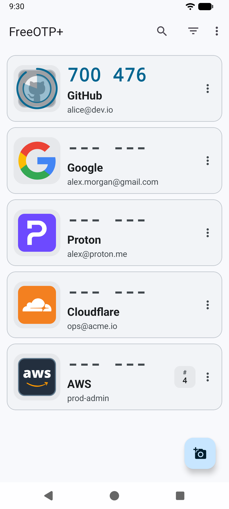

# FreeOTP Plus

FreeOTP Plus (FreeOTP+) is a modern, privacy-focused fork of Red Hat's [FreeOTP](https://github.com/freeotp/freeotp-android) two-factor authenticator with the following enhancements:
* **Backup & Restore**: Export and import tokens in JSON or Key URI (`otpauth://`) format (plaintext or AES-256-GCM encrypted, with automatic encrypted backup detection) and back up custom token images as a `.zip` archive via Google Drive or any Storage Access Framework document provider
* **Three Authentication Modes**: **None**, **App launch** (Biometric / PIN), and **Token encrypted** (AES-256-GCM encrypted token secrets unlocked via biometric or manual key), with automatic background session locking
* **100% Offline & Privacy-Hardened**: Requires **no `INTERNET` or storage permissions**, blocks screenshots across all screens (`FLAG_SECURE`), marks copied OTP codes as sensitive with automatic clipboard clearing, and enforces client-side encryption for Android cloud backups (API 28+)
* **Material Design 3 UI**: Modern single-Activity interface with **System default / Light / Dark** theme selection
* **450+ Built-in Offline Icons & Custom SVG/Image Support**: Automatic heuristic icon matching for 450+ services, a searchable built-in icon picker, and custom raster or SVG token icons
* **Categories, Search & Sorting**: Assign multiple categories per token, filter by category chips, search tokens instantly, and sort by account, issuer, or custom drag-and-drop order
* **Rich Token Management**: View and edit token details (including HOTP counter), share tokens via QR code, or copy token URIs for interoperability with other authenticators
* **Fast QR Scanning**: Powered by CameraX with automatic front-camera fallback on devices without a rear camera
* **Broad Compatibility**: Supports Android 6.0+ (`minSdk 23`) with extensive reliability and security improvements

Most of the codebase has been rewritten in Kotlin using modern Android Jetpack libraries.

## Requirements

* Android 6.0+

## Screenshots

## Build Dependencies

* Android SDK (`compileSdk 37`)
* JDK 17+ / Android Studio

## Translate

If you want a new translation for your language, please [open a GitHub issue](https://github.com/helloworld1/FreeOTPPlus/issues) requesting the language.
The project owner/collaborators will check in an initial translation using machine translation, after which contributors can fine-tune the translations directly on GitHub via pull requests.

## Authentication Modes & Token Encryption

Under **Authentication mode** in the menu, FreeOTP+ supports three modes:

* **None**: Default mode without an authentication prompt on launch; token secrets are stored unencrypted in app-private storage.
* **App launch**: Prompts for Biometric or device PIN/credential when opening the app (and after a 2-minute background timeout), without encrypting token secrets in storage.
* **Token encrypted**: Encrypts token secrets at rest with AES-256-GCM using a user-supplied key (minimum 6 characters, derived via PBKDF2-HMAC-SHA256). The key is encrypted with `AndroidKeyStore` strong biometrics when available so launching the app with biometrics automatically unlocks your tokens. If biometrics are not enrolled or become invalidated (e.g., new biometric enrolled or app restored to a new phone), you will be prompted to enter your key manually with the option to enable/re-enable biometric unlock.
  * To rotate your encryption key, switch out of **Token encrypted** mode (which decrypts stored secrets after confirmation) and switch back into **Token encrypted** mode with a new key.
  * When exporting backups (JSON or Key URI) in **Token encrypted** mode, you can choose to export **encrypted** (`freeotp-backup-encrypted_<datetime>.json` / `.txt`) or **decrypted** (`freeotp-backup_<datetime>.json` / `.txt`).

## Backup & Import Notes

* **JSON & Key URI Backups**:
  * Plaintext JSON backups preserve token order, multiple categories, HOTP counters, and built-in icon selections.
  * When importing from legacy plaintext JSON, at least one of `label` or `issuerExt` is required, `secret` must be an array/list of signed/unsigned byte integer values, and `tokenOrder` is required (tokens not listed in `tokenOrder` are ignored).
  * When importing an encrypted JSON or Key URI backup (`freeotp-backup-encrypted_*`), FreeOTP+ automatically detects encryption and prompts for the backup's encryption key regardless of the app's current authentication mode.
* **Custom Token Images Backup (`.zip`)**:
  * Built-in icons selected via **Choose built-in icon** are stored as portable references inside JSON and Key URI backups automatically.
  * User-uploaded custom raster/SVG token icons can be exported and restored across devices via **Export -> Token images (.zip)** and **Import -> Token images (.zip)**.
